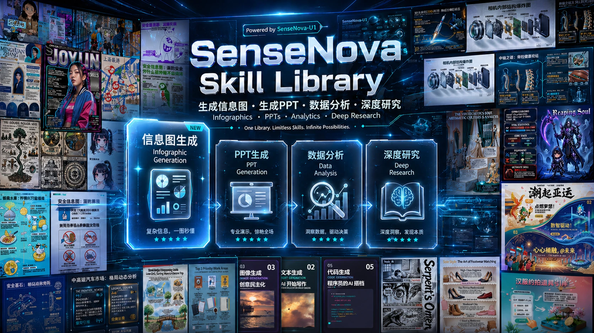

# SenseNova Image & Visualization Skills

English | [简体中文](README_CN.md)



This branch is intentionally focused: it contains only five complete image and visualization skills. It is designed for any Agent Skills-compatible host and uses `sensenova-u1.6-lite` as the default model for image generation and editing. Model use follows the account's current plan and credit rules.

## Included skills

| Skill | Capability |
|---|---|
| [`sn-image-base`](skills/sn-image-base/SKILL.md) | U1.6 text-to-image, native multi-reference editing, composition and blending, explicit optional text/vision adapters, and an optional explicit fallback (off by default) |
| [`sn-image-doctor`](skills/sn-image-doctor/SKILL.md) | Local installation, dependency, key, endpoint, model, sizing, and watermark diagnostics plus repository Release checks |
| [`sn-infographic`](skills/sn-infographic/SKILL.md) | 87 layouts, 66 styles, prompt expansion, 1-15 user-bounded rounds, visual review, evidence-based editing/regeneration, and result ranking |
| [`sn-image-imitate`](skills/sn-image-imitate/SKILL.md) | Reference analysis, content rewrite, U1.6 native imitation, consistency review, and ranked retries |
| [`sn-image-resume`](skills/sn-image-resume/SKILL.md) | Fact-preserving visual resumes with content-first/portfolio layouts and edit-based correction |

The full bilingual infographic gallery remains available in [English](docs/sn-infographic-examples.md) and [Chinese](docs/sn-infographic-examples_CN.md).

## Natural-language use (recommended)

You do not need to remember the three user-facing skill names. Start with “Use SenseNova skills…” and describe the intent. Terms such as infographic, reference-image redesign, resume poster, or multi-image blending help an Agent Skills-compatible host choose the corresponding skill.

```text
Use SenseNova skills to create a renewable-energy infographic
Use SenseNova skills to redesign this reference image for my product
Use SenseNova skills to create a resume poster
```

## Defaults

- Primary: `sensenova-u1.6-lite`
- Generation-only fallback: off by default; enable explicitly with `SN_IMAGE_GEN_FALLBACK_MODEL` or `--fallback-model`
- Text self-correction: on (`self_correction=true` sent explicitly)
- Watermark: off
- U1.6 prompt extension: on
- U1.6 response: Base64 saved immediately to disk
- Text/vision model: none; the host Agent plans and reviews by default

Automatic fallback is off by default. Once a fallback model is configured explicitly, it is used only for recoverable text-to-image failures (404, 429, or retry-exhausted 5xx). Automatic fallback never applies to image editing, authentication/authorization failures, bad parameters, safety blocks, or local file problems. `sensenova-u1.5-fast` and `sensenova-u1-fast` are retired and unsupported; release metadata blocks them during update checks. Migrate to `sensenova-u1.6-lite`.

The repository deliberately sends `watermark=false`. SenseNova currently offers watermark removal free during public beta and documents it as a premium paid feature after the beta; review account charges before production use when that policy changes.

See the official [SenseNova API documentation](https://platform.sensenova.cn/docs) and find the `SenseNova U1.6 Lite` section by its heading (the only image model in the current overview). The documentation site's deep links are not reliable on a cold load.

## Quick start

```bash
python -m venv .venv
```

Before installing dependencies, activate the virtual environment for your shell. On Windows PowerShell, run:

```powershell
.\.venv\Scripts\Activate.ps1
```

On macOS/Linux, run:

```bash
source .venv/bin/activate
```

The following commands assume this virtual environment is activated and `python` refers to its interpreter. If it is not activated, use the interpreter's absolute path instead. The Agent host must use the same interpreter.

```bash
python -m pip install -r skills/sn-image-base/requirements.txt
```

Copy `.env.example` to an ignored `.env` and set only your key for the default setup:

```dotenv
SENSENOVA_API_KEY=your-key
```

One shared key is sufficient. If a capability uses a different credential, set its optional `SN_IMAGE_GEN_API_KEY`, `SN_CHAT_API_KEY`, `SN_TEXT_API_KEY`, or `SN_VISION_API_KEY`. Image resolution is CLI argument > `SN_IMAGE_GEN_API_KEY` > `SENSENOVA_API_KEY`; text and vision resolution is CLI argument > their capability-specific key > `SN_CHAT_API_KEY` > `SENSENOVA_API_KEY`. See [Installation](INSTALL.md#configure) for details.

The runtime searches for `.env` from the current task directory upward; use `SN_ENV_FILE` for an explicit absolute path when the host runs elsewhere. Doctor reports the Python executable and environment-file path so the host runtime is easy to verify.

Run diagnostics:

```bash
python skills/sn-image-doctor/scripts/check_environment.py --verbose
```

Generate:

```bash
python skills/sn-image-base/scripts/sn_agent_runner.py sn-image-generate \
  --prompt "A clean bilingual infographic about renewable energy" \
  --image-size 2k \
  --aspect-ratio 16:9 \
  --save-path output.png \
  --output-format json
```

Edit or continue editing:

```bash
python skills/sn-image-base/scripts/sn_agent_runner.py sn-image-edit \
  --prompt "Keep the layout and correct the title" \
  --images output.png \
  --save-path corrected.png \
  --output-format json
```

For installation into an Agent Skills host, see [INSTALL.md](INSTALL.md). API and CLI details are in [the image guide](docs/sn-image-generate_en.md).

## Update installed skills

The five skills share one version. Runner and Doctor check the latest full repository Release at most once every 24 hours and cache the result per installation. The check never calls model endpoints or sends keys or task content. Force a check with Doctor's `--check-update` or Runner's `sn-check-update`. Git, symlink, and copied-install update steps are in [INSTALL.md](INSTALL.md#update-installed-skills).

## Security

Never commit API keys. Use an ignored `.env`, your Agent's secret store, or temporary non-echo environment injection. JSON and diagnostics mask secrets and never intentionally print request authorization headers.

## License

See [LICENSE](LICENSE).
