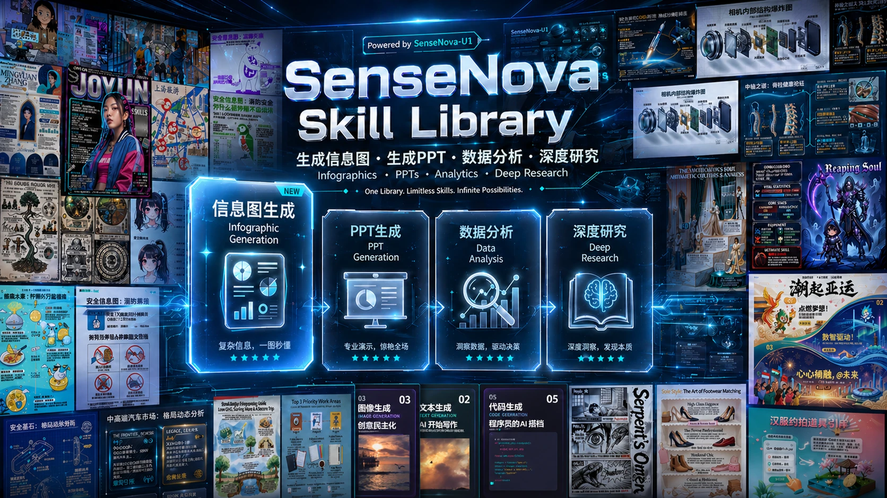

# SenseNova 图像与可视化技能

[English](README.md) | 简体中文



本分支只维护 5 个完整的“图像与可视化”技能，适用于任何兼容 Agent Skills 的智能体。生图与图片编辑默认使用 `sensenova-u1.6-lite`；模型调用按账号当前套餐及积分规则计费。

## 保留的技能

| Skill | 能力 |
|---|---|
| [`sn-image-base`](skills/sn-image-base/SKILL.md) | U1.6 文生图、原生多参考图编辑、合成与融合、显式可选的文本/视觉适配器，以及默认关闭、可显式指定的回退 |
| [`sn-image-doctor`](skills/sn-image-doctor/SKILL.md) | 本地检查安装、依赖、Key、端点、模型、尺寸及无水印默认值，并检查仓库 Release 更新 |
| [`sn-infographic`](skills/sn-infographic/SKILL.md) | 87 种布局、66 种风格、提示词扩写、用户限定的 1–15 轮生成、视觉评审、按问题选择编辑或重新生成，以及质量排序 |
| [`sn-image-imitate`](skills/sn-image-imitate/SKILL.md) | 参考图解析、内容改写、U1.6 原生仿制、一致性评审与多轮排序 |
| [`sn-image-resume`](skills/sn-image-resume/SKILL.md) | 事实不虚构、正文优先/作品集双版式、生成后编辑纠错的可视化简历 |

完整的信息图中英文案例库仍保留：[中文](docs/sn-infographic-examples_CN.md) / [English](docs/sn-infographic-examples.md)。

## 自然语言使用（推荐）

无需记忆三个用户技能名，只需用“用 SenseNova 技能……”表达需求。信息图、参考图改版、简历海报或多图融合等意图词会帮助兼容的 Agent Skills 宿主自动选择相应技能。

```text
用 SenseNova 技能做一张新能源信息图
用 SenseNova 技能照这张图改版，换成我的产品
用 SenseNova 技能帮我做简历海报
```

## 默认策略

- 首选模型：`sensenova-u1.6-lite`
- 文生图回退：默认关闭，可用 `SN_IMAGE_GEN_FALLBACK_MODEL` 或 `--fallback-model` 显式指定
- 文字自修正：默认开启（显式发送 `self_correction=true`）
- 默认无水印
- 默认启用 U1.6 提示词扩展
- U1.6 默认返回 Base64 并立即落盘
- 不设置默认文本/视觉聊天模型；优先由当前 Agent 完成规划和评审

自动回退默认关闭。显式配置回退模型后，只有文生图遇到 404、429 或同模型重试后仍失败的 5xx 才自动回退。图片编辑、401/403、参数/安全错误和本地文件错误均不回退。`sensenova-u1.5-fast` 与 `sensenova-u1-fast` 已退役且不再受支持；发布清单标记下线时，更新检查会阻断这些模型，请迁移到 `sensenova-u1.6-lite`。

本仓库有意显式发送 `watermark=false`。SenseNova 当前在公测期免费开放无水印，官方说明公测结束后将作为高级付费特性；届时用于生产前应先确认账号费用。

请打开 [SenseNova API 官方文档](https://platform.sensenova.cn/docs)，按标题查找 `SenseNova U1.6 Lite`（当前模型总览中唯一的图像模型）。文档站的深链接在首次加载时不能可靠定位。

## 快速开始

```bash
python -m venv .venv
```

安装依赖前，必须按当前终端激活虚拟环境。Windows PowerShell 执行：

```powershell
.\.venv\Scripts\Activate.ps1
```

macOS/Linux 执行：

```bash
source .venv/bin/activate
```

后续命令假定已激活该虚拟环境，`python` 指向其中的解释器。若未激活，请使用该解释器的绝对路径；Agent 宿主也须使用同一解释器。

```bash
python -m pip install -r skills/sn-image-base/requirements.txt
```

复制 `.env.example` 为本地 `.env`，默认配置只需填写：

```dotenv
SENSENOVA_API_KEY=your-key
```

通常只需这一个共享 Key。仅当某项能力使用不同凭证时，才设置可选的 `SN_IMAGE_GEN_API_KEY`、`SN_CHAT_API_KEY`、`SN_TEXT_API_KEY` 或 `SN_VISION_API_KEY`。图片能力的读取顺序为命令行参数 > `SN_IMAGE_GEN_API_KEY` > `SENSENOVA_API_KEY`；文本与视觉能力为命令行参数 > 对应能力专用 Key > `SN_CHAT_API_KEY` > `SENSENOVA_API_KEY`。详见[安装说明](INSTALL_CN.md#配置)。

运行时从当前任务目录向上查找 `.env`；宿主从其他目录运行时，可用 `SN_ENV_FILE` 指定绝对路径。Doctor 会显示实际 Python 与配置文件路径，便于确认宿主使用了正确环境。

检查环境：

```bash
python skills/sn-image-doctor/scripts/check_environment.py --verbose
```

文生图：

```bash
python skills/sn-image-base/scripts/sn_agent_runner.py sn-image-generate \
  --prompt "一张清晰的双语可再生能源信息图" \
  --image-size 2k \
  --aspect-ratio 16:9 \
  --save-path output.png \
  --output-format json
```

编辑或连续修改：

```bash
python skills/sn-image-base/scripts/sn_agent_runner.py sn-image-edit \
  --prompt "保持版式，修正标题文字" \
  --images output.png \
  --save-path corrected.png \
  --output-format json
```

Agent Skills 安装方法见 [INSTALL_CN.md](INSTALL_CN.md)，CLI 与 API 细节见[图像指南](docs/sn-image-generate.md)。

## 更新已安装技能

五个技能共享版本。Runner 和 Doctor 每 24 小时最多检查一次仓库最新正式 Release，结果按安装隔离缓存；检查不访问模型端点，也不发送 Key 或任务内容。可运行 Doctor 的 `--check-update` 或 Runner 的 `sn-check-update` 强制检查。Git、软链接和复制安装的更新步骤见 [INSTALL_CN.md](INSTALL_CN.md#更新已安装技能)。

## 安全

禁止提交 API Key。请使用被 Git 忽略的 `.env`、Agent 的密钥存储或临时非回显环境注入。JSON 与 Doctor 输出会脱敏，不会主动打印授权请求头。

## 许可证

见 [LICENSE](LICENSE)。
